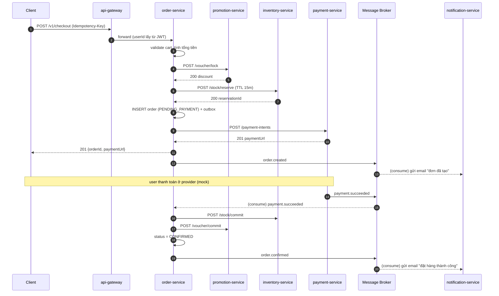

# architecture.md — ShopLab: Kiến trúc tổng quát

| | |
|---|---|
| **Trạng thái** | `DRAFT v0.5` — Phase 0 · Phase 1 · Phase 2 **hoàn thành** (tag `phase-2`); Phase 3 (async & event-driven) đang làm: đã chốt contract event ([ADR-0007](docs/adr/0007-event-contract.md)) |
| **Người thực hiện** | bạn + AI |
| **Cập nhật lần cuối** | 2026-11-09 (`SL-3.6` — `catalog` outbox + `search-service` 8091 Postgres FTS + reconcile, §6.4) |
| **Liên quan** | `AGENTS.md`, `Backlog.md`, `Backlog-phase-0.md`, `docs/adr/`, `docs/phases/` |

---

## 0. TL;DR — đọc nhanh trong 60 giây

**ShopLab** là một sàn thương mại điện tử multi-seller (kiểu Shopee/Tiki) được dựng lại từ đầu
theo kiến trúc **microservices**, mục đích là **học architecture** ở quy mô **high traffic**.

- **Không** dựng hết một lượt. Đi theo **phase**, mỗi phase giải quyết 1 nhóm bài toán và phải
  chạy được end-to-end mới đi tiếp. Xem §12 Roadmap và `Backlog.md`.
- **Service đầu tiên** sẽ là `api-gateway` + `identity-service` + `catalog-service` (Phase 1),
  sau đó mới mở rộng sang order / payment / inventory (Phase 2).
- **Nguyên tắc xuyên suốt**: mỗi service sở hữu **database riêng**, giao tiếp qua **API + event**,
  cross-service dùng **Saga** + **eventual consistency**, không share DB, không distributed transaction.
- Khác với tutorial thông thường: mọi pattern đều được đặt trong **bài toán có số liệu**
  (RPS, p99, error budget) để thấy rõ **trade-off**, không học pattern cho có.

---

## 1. Bối cảnh & mục tiêu học

### 1.1. Vì sao chọn e-commerce

E-commerce là domain "đủ khó": vừa **read-heavy** (xem sản phẩm), vừa **write-critical**
(đặt hàng, thanh toán), vừa có **spike traffic** (flash sale), vừa cần **consistency** (không được
oversell, không được trừ tiền 2 lần). Đây là bài toán mà gần như mọi pattern của microservices đều
có đất dùng.

### 1.2. Mục tiêu học (learning outcomes)

Sau khi đi hết roadmap, cần nắm được:

| # | Nhóm kiến thức | Nội dung cụ thể |
|---|---|---|
| 1 | Service decomposition | Chia theo **bounded context** / business capability, xác định service boundary, tránh distributed monolith |
| 2 | Communication | Sync (REST/gRPC) vs Async (event), khi nào dùng cái nào, coupling & contract versioning |
| 3 | Data consistency | Database per service, **Saga** (orchestration vs choreography), **transactional outbox**, idempotency, eventual consistency |
| 4 | Scalability | Caching, **read replica**, **sharding / partitioning**, connection pool, **load balancing** L4/L7, horizontal scaling |
| 5 | Resilience | Timeout, retry + backoff + jitter, **circuit breaker**, bulkhead, **backpressure**, **dead letter queue**, graceful degradation |
| 6 | Observability & SRE | Structured log, metrics (RED/USE), **distributed tracing**, **SLO / SLI / error budget**, alerting, runbook |
| 7 | Deployment | Containerize, CI/CD, K8s, HPA, **blue-green / canary**, config & secret management |
| 8 | Trade-off thinking | Luôn trả lời được: đổi cái này lấy cái gì, chịu được tới đâu, khi nào revisit |

### 1.3. Cách học

Mỗi phase đi theo vòng: **hiểu vấn đề → dựng bản chạy được → đo → thấy nó vỡ → refactor bằng pattern**.

Ví dụ Phase 4: cho `catalog-service` chạy **không cache**, load test bằng k6 thấy p99 tăng vọt
→ mới thêm cache-aside → đo lại. Học bằng số liệu, không học bằng niềm tin.

---

## 2. Domain & phạm vi

### 2.1. Actors

| Actor | Mô tả |
|---|---|
| Guest | Xem sản phẩm, tìm kiếm, thêm vào giỏ |
| Buyer | Đã đăng nhập — checkout, thanh toán, xem đơn, review |
| Seller | Đăng sản phẩm, quản lý tồn kho, xem đơn của shop mình |
| Admin | Quản lý user, duyệt seller, cấu hình campaign |

### 2.2. Capability map (in scope)

| # | Capability | Service phụ trách | Phase |
|---|---|---|---|
| 1 | Identity & Access | `identity-service` | 1 |
| 2 | Product Catalog | `catalog-service` | 1 |
| 3 | Cart | `cart-service` | 2 |
| 4 | Inventory | `inventory-service` | 2 |
| 5 | Promotion / Voucher / Flash sale | `promotion-service` | 2 |
| 6 | Order | `order-service` | 2 |
| 7 | Payment | `payment-service` | 2 |
| 8 | Notification | `notification-service` | 3 |
| 9 | Search | `search-service` | 3 |
| 10 | Review & Rating | `review-service` | 8 |
| 11 | Shipping / Fulfillment | `shipping-service` | 8 |
| 12 | Analytics / Reporting | `analytics-service` | 8 |

### 2.3. Out of scope (non-goals)

- Recommendation / ML cá nhân hoá, ads, livestream, chat buyer-seller, affiliate.
- Tích hợp payment provider thật → dùng **mock provider** mô phỏng đủ case
  success / fail / timeout / **duplicate callback**.
- Multi-region thật → chỉ làm **design doc** ở Phase 8, không dựng hạ tầng.
- Mobile app / UI đẹp → chỉ cần REST client (curl / Postman / script) để test.

---

## 3. Yêu cầu phi chức năng (NFR) & mục tiêu scale

Đây là **target để thiết kế và để load test**, không phải cam kết SLA. Số liệu chọn ở mức
"startup đang lớn" — đủ lớn để pattern có ý nghĩa, đủ nhỏ để chạy được trên 1 máy dev.

| Nhóm | Chỉ số | Target | Ghi chú |
|---|---|---|---|
| Traffic | DAU | 1.000.000 | peak concurrent ≈ 50.000 |
| Traffic | Read RPS (peak) | 50.000 | normal ≈ 5.000; read:write ≈ 20:1 |
| Traffic | Write RPS (peak) | 5.000 | flash sale spike ~10x trong 60s |
| Latency | p99 read | < 150 ms | đo tại gateway |
| Latency | p99 write (checkout) | < 500 ms | không tính thời gian user thanh toán ở provider |
| Availability | Uptime | 99.95% / tháng | error budget ≈ 21 phút / tháng |
| Consistency | Order & Payment | **Strong** | không oversell, không double charge |
| Consistency | Catalog / Search / Notification | **Eventual** | trễ vài giây chấp nhận được |
| Durability | Order / Payment | RPO = 0 | không được mất bản ghi đã ghi nhận |
| Recovery | RTO / RPO | 15 phút / 5 phút | áp dụng cho service khác order/payment |
| Cost | Chi phí hạ tầng | không tối ưu ở giai đoạn học | ghi nhận, không ràng buộc |

**Bài toán spike traffic (flash sale)** — đây là "final boss" của hệ thống:

- 1 SKU, 10.000 sản phẩm, 500.000 người bấm mua trong 60 giây.
- Yêu cầu: **không oversell**, **không sập**, **không treo** những API khác.
- Đây là lý do cần: rate limit ở gateway, queue + backpressure, cache pre-warm, reservation trong
  inventory, và graceful degradation cho phần không critical.

---

## 4. Kiến trúc tổng quát

### 4.1. C4 Level 1 — System Context

```
      ┌─────────────┐        ┌──────────────┐        ┌─────────────┐
      │  Web (SPA)  │        │  Mobile App  │        │ Seller Tool │
      └──────┬──────┘        └──────┬───────┘        └──────┬──────┘
             │                      │                       │
             └──────────────────────┼───────────────────────┘
                                    │ HTTPS
                                    ▼
                    ┌───────────────────────────────┐
                    │        CDN + WAF              │  static asset, chống bot/L7 attack
                    └───────────────┬───────────────┘
                                    ▼
                    ┌───────────────────────────────┐
                    │   Load Balancer (L7)          │  TLS termination, health check
                    └───────────────┬───────────────┘
                                    ▼
        ╔═══════════════════════════════════════════════════════════════╗
        ║                        ShopLab Platform                       ║
        ║   API Gateway → domain services → data stores → broker        ║
        ╚═══════════════════════════════════════════════════════════════╝
             │                    │                        │
             ▼                    ▼                        ▼
   ┌──────────────────┐  ┌──────────────────┐  ┌────────────────────┐
   │ Payment Provider │  │ Email/SMS/Push   │  │ Shipping Partner   │
   │     (mock)       │  │     (mock)       │  │      (mock)        │
   └──────────────────┘  └──────────────────┘  └────────────────────┘
```

---

### 4.2. C4 Level 2 — Container view

```
                        ┌────────────────────────────────┐
   Client ──HTTPS──▶    │   api-gateway                  │
                        │   authn · rate limit · routing │
                        │   aggregation · correlation id │
                        └───────────────┬────────────────┘
                                        │  REST (sync) + gRPC (sync, internal)
   ═════════════════════════════════════╪══════════════════════════════════════════
    DOMAIN SERVICES  (mỗi service = 1 deployable unit + 1 database riêng)
   ═════════════════════════════════════╪══════════════════════════════════════════
        ┌───────────────┬───────────────┼───────────────┬───────────────┐
        ▼               ▼               ▼               ▼               ▼
  ┌───────────┐  ┌───────────┐  ┌───────────┐  ┌────────────┐  ┌────────────┐
  │ identity  │  │  catalog  │  │   cart    │  │ inventory  │  │ promotion  │
  │ -service  │  │ -service  │  │ -service  │  │ -service   │  │ -service   │
  └─────┬─────┘  └─────┬─────┘  └─────┬─────┘  └─────┬──────┘  └─────┬──────┘
        │              │              │              │               │
     (users)      (catalog)      (Redis TTL)   (inventory)      (promotion)

  ┌───────────┐  ┌───────────┐  ┌────────────┐  ┌───────────┐  ┌────────────┐
  │   order   │  │  payment  │  │notification│  │  search   │  │ shipping * │
  │ -service  │  │ -service  │  │  -service  │  │ -service  │  │ -service   │
  └─────┬─────┘  └─────┬─────┘  └──────┬─────┘  └─────┬─────┘  └─────┬──────┘
        │              │               │              │              │
     (orders)      (payments)      (notif log)   (OpenSearch)   (shipping)

   ═════════════════════════════════════╪══════════════════════════════════════════
    PLATFORM INFRASTRUCTURE              │
   ═════════════════════════════════════╪══════════════════════════════════════════
   ┌────────────┬─────────┬─────────────┴───┬────────────┬──────────────┬───────────┐
   │ PostgreSQL │  Redis  │  Message Broker │ OpenSearch │ Object Store │Observabil.│
   │ (per svc)  │         │ (event + queue) │            │ (MinIO/S3)   │ OTel+Prom │
   └────────────┴─────────┴─────────────────┴────────────┴──────────────┴───────────┘

   (*) service ở phase sau
```

**Nguyên tắc bất di bất dịch:**

1. **Database per service** — không service nào đọc DB của service khác. Cần dữ liệu của nhau thì
   gọi API, hoặc giữ **read model** riêng cập nhật qua event.
2. **Sync cho đường cần kết quả ngay** (validate voucher, reserve stock), **async cho phần
   không cần chặn user** (gửi email, update search index, ghi analytics).
3. **Mọi service stateless** — state đẩy xuống DB/Redis, để scale ngang chỉ cần tăng replica.
4. **Mọi service có `/health` (liveness) + `/ready` (readiness)** — phục vụ load balancer và K8s probe.
5. **Không distributed transaction (2PC)** — cross-service dùng **Saga + compensating action**.

### 4.3. Vì sao có API Gateway

| Nếu không có gateway | Nếu có gateway |
|---|---|
| Client phải biết địa chỉ của từng service → coupling cứng | Client chỉ biết 1 endpoint |
| Auth phải lặp lại ở mọi service | Authn/authz tập trung 1 chỗ |
| Rate limit / CORS / logging phải làm lại N lần | Cross-cutting làm 1 lần |
| Không có chỗ chống abuse / bot | Dễ thêm WAF, bot detection |

**Trade-off**: gateway là **single point of failure** và có thể thành **bottleneck**. Giảm thiểu bằng
cách chạy nhiều instance + giữ logic gateway **mỏng** (chỉ cross-cutting, không chứa business logic).

---

## 5. Service catalog & data ownership

| Service | Trách nhiệm chính | Sở hữu data (source of truth) | Storage | Giao tiếp | Phase |
|---|---|---|---|---|---|
| `api-gateway` | Edge: routing, verify JWT, rate limit, request aggregation, correlation id | không sở hữu business data | Redis (rate limit counter) | REST in / REST-gRPC out | 1 |
| `identity-service` | Đăng ký, đăng nhập, phát & refresh JWT, profile, role | `users`, `credentials`, `refresh_tokens`, `roles` | PostgreSQL | REST | 1 |
| `catalog-service` | Product, SKU, category, brand, media ref, giá niêm yết | `products`, `skus`, `categories`, `brands` | PostgreSQL + Redis cache | REST/gRPC | 1 |
| `cart-service` | Giỏ hàng tạm (**guest token** + user), merge khi login, TTL 30 ngày; ghi bằng **Lua** (read-modify-write nguyên tử) | **Redis HASH** `cart:<owner>` + marker `cart:guest:<token>` — **không có Postgres** | Redis (TTL) | REST | 2 |
| `inventory-service` | Tồn kho theo SKU × warehouse; **reserve / commit / release** (conditional `UPDATE`, ADR-0006) | `stock`, `reservations` (+`reservation_items`), `stock_ledger` | PostgreSQL | REST | 2 |
| `promotion-service` | Voucher (PERCENT/FIXED), rule tính giảm giá, **lock/commit/release** 1 lượt dùng | `vouchers`, `voucher_locks` | PostgreSQL | REST | 2 |
| `order-service` | Vòng đời order (**idempotent** theo `Idempotency-Key`), snapshot giá; orchestrator Saga (SL-2.6) | `orders`, `order_items`, `order_status_history`, `idempotency_keys`, `outbox` | PostgreSQL | REST + event | 2 |
| `payment-service` | Payment intent (**idempotent**), nhận webhook provider (**idempotent** theo khoá tự nhiên), mock provider cho Phase 2; refund để Phase 6 | `payments`, `payment_webhook_events`, `idempotency_keys` (`transactions`/`refunds`/`outbox` chưa có) | PostgreSQL | REST + webhook | 2 |
| `notification-service` | Email / SMS / Push theo template | `notification_logs`, `templates` | PostgreSQL | **async consumer** | 3 |
| `search-service` | Index & query sản phẩm (full-text, filter, sort) | search index (không phải source of truth) | **PostgreSQL FTS** (Phase 3, port **8091**) → OpenSearch (Phase 8) | REST + consumer | 3 |
| `review-service` | Review, rating, moderation | `reviews`, `ratings` | PostgreSQL | REST + event | 8 |
| `shipping-service` | Tạo vận đơn, tracking status | `shipments`, `tracking_events` | PostgreSQL | REST + event | 8 |
| `analytics-service` | Tổng hợp số liệu bán hàng / funnel | `fact_*`, `dim_*` | ClickHouse (hoặc Postgres) | **CDC / consumer** | 8 |

**Quy tắc phụ thuộc (dependency rule):**

- Service **không** gọi vòng (A → B → A). Nếu cần → tách qua event.
- `order-service` là **orchestrator** của checkout, được phép gọi sync `cart` (đọc giỏ), `catalog` (batch giá
  SKU), `inventory`, `promotion`, `payment` — nhưng theo một chiều, và **bắt buộc** có timeout + circuit breaker.
  Hai phụ thuộc **đọc** (`cart`, `catalog`) không tạo vòng: chúng không biết gì về order.
- `catalog-service` **không** biết gì về order. `inventory-service` **không** biết gì về user.
  Cần biết → nhận event.

---

## 6. Luồng nghiệp vụ chính

### 6.1. Checkout (happy path) — Saga orchestration



**Compensating action (khi fail):**

| Bước fail | Cần làm gì để "undo" |
|---|---|
| Lock voucher fail | Dừng, trả 4xx cho user, chưa tạo order |
| Reserve stock fail | Release voucher đã lock, trả 4xx |
| Tạo payment fail | Release stock + release voucher, order = `CANCELLED` |
| User không thanh toán trong 15' | Job release stock + voucher, order = `EXPIRED` |
| Payment fail / callback `failed` | Release stock + voucher, order = `CANCELLED`, thông báo user |

> Vì sao **reserve** rồi mới **commit** thay vì trừ stock luôn? Vì giữa lúc đặt và lúc thanh toán
> có thể mất vài phút — nếu trừ luôn thì user bỏ ngang sẽ làm "cháy" hàng ảo. Reserve giữ chỗ
> có TTL, commit chỉ khi tiền đã về.

**Cơ chế đã chốt — [ADR-0006](docs/adr/0006-checkout-model.md)** (chốt ở `SL-2.0`, mọi ticket Phase 2 bám theo):

| Điểm | Chốt | Hệ quả |
|---|---|---|
| Chống oversell | **conditional `UPDATE`** trên `stock`: `… WHERE on_hand - reserved >= :qty`; `0` row ⇒ `409` (không dùng Redis lock) | Nguyên tử ở row lock của DB, không thêm hạ tầng; reserve nhiều SKU = 1 transaction, sắp `sku_id` để tránh deadlock |
| Reservation | TTL **15 phút**; sweeper `@Scheduled` 60 s (batch 100, `FOR UPDATE SKIP LOCKED`) + lazy expire ở `commit` (`410`) | Hàng bị giữ được trả lại kể cả khi process restart; nhiều instance sweeper vẫn không trả chỗ 2 lần (`SL-2.3`) |
| Idempotency | Bảng `idempotency_keys` (Postgres), PK `(scope, key)`, `scope = userId:endpoint`; có `request_hash` + lưu response ⇒ retry **replay** đúng kết quả cũ | Bấm 2 lần / retry sau timeout không tạo 2 order; Redis chỉ dùng làm fast-path sau này |
| `order_items` | **Snapshot** (`sku_code`, `title`, `unit_price`, `currency`) + `sku_id` không FK | Hoá đơn bất biến; đổi giá/xoá SKU ở `catalog` không làm sai đơn cũ |
| Sync vs async | Phase 2 **sync REST** (timeout mỗi bước 300–800 ms) + compensating | p99 mục tiêu ~125 ms; async/outbox để Phase 3 (có baseline để so sánh) |
| `TD-12` | Soft delete product (`status = ARCHIVED` + `deleted_at`), code ở `SL-2.11` | `stock_ledger`/`reservations` còn tham chiếu được `sku_id` ⇒ reconcile được |

**API của `order-service` cho saga** (`SL-2.6a`, đã chạy thật): `POST /v1/checkout` (bắt buộc
`Idempotency-Key`, body chỉ `{voucherCode?}` — dòng hàng lấy từ giỏ) → **201** `{orderId, status, subtotal, discount,
total, currency, paymentRequired, paymentIntentId, paymentUrl}`; retry cùng key → **200** + `Idempotent-Replayed`.
`GET /v1/checkout/{orderId}` → trạng thái saga (`state`, `lockId`, `reservationId`, `paymentIntentId`, `failureCode`).

Saga lưu state ở 2 bảng trong DB `order`: `checkout_sagas` (1 dòng/đơn: state · `payment_required` · các id đã giữ ·
`failure_code`) và `checkout_saga_steps` (audit từng bước: `CART · PRICE · VOUCHER_LOCK · STOCK_RESERVE ·
ORDER_CREATE · PAYMENT_INTENT` + http status + thời gian). Đơn 0 đồng (voucher 100%) ⇒ `payment_required = false`,
không tạo payment intent ([ADR-0006](docs/adr/0006-checkout-model.md) D6).

**Bước hoàn tất** (`SL-2.6b`): `POST /v1/checkout/{orderId}/confirm` — saga **tự** hỏi `payment-service` xem intent đã
`SUCCEEDED` chưa (không tin client) rồi `commit` stock → voucher ⇒ order `CONFIRMED` + saga `CONFIRMED`;
`POST /v1/checkout/{orderId}/cancel` — `release` stock + voucher ⇒ `CANCELLED`. `CheckoutSagaSweeper` quét mỗi 60 s:
đơn quá `payment-window` (**15′ = TTL reservation/lock**) mà còn `PENDING_PAYMENT` ⇒ order + saga `EXPIRED`.
Sweeper **không gọi** `release` (chạy nền, không có token user) — hàng/voucher do TTL sweeper của
`inventory`/`promotion` trả (ADR-0006 D7, nợ `TD-25`).

**Nguồn dữ liệu của saga (chốt 2026-11-08 — phương án B, `SL-2.13` + `SL-2.6a`):** `order-service` **đọc giỏ** từ
`cart-service` (`GET /v1/carts`, forward JWT của user) rồi lấy giá/tên bằng **batch** `GET /v1/skus?ids=` của
`catalog-service`. Vì sao không đọc giá từ client: giá do client gửi là mời gọi sửa 1 field để trả ít tiền hơn. Vì sao
cart không tự lưu giá: `TD-20` — giá là dữ liệu của `catalog`, copy sang cart là dựng nguồn sự thật thứ hai sẽ lệch.
Batch là bắt buộc: giỏ N dòng khác product ⇒ N round-trip nếu tra từng SKU, cộng thẳng vào p99 checkout.

**API của `inventory-service`** (`SL-2.2`, đã chạy thật): `PUT /v1/stock/{skuId}` (admin đặt `onHand`) ·
`GET /v1/stock/{skuId}` → `{onHand, reserved, available}` · `POST /v1/stock/reserve` (`{orderId, items[]}` →
`201 {reservationId, expiresAt}`; retry cùng `orderId` → `200` cùng id; thiếu hàng → `409` + `details`) ·
`POST /v1/stock/commit` (→ `200`; quá TTL → `410`; đã release → `409`) · `POST /v1/stock/release` (→ `200`, idempotent).
Mọi giao dịch ghi thêm 1 dòng `stock_ledger`, đối soát bằng `Σ delta_on_hand` / `Σ delta_reserved`.

**API của `catalog-service` cho saga** (`SL-2.13`, đã chạy thật): `GET /v1/skus?ids=<uuid>,<uuid>…` (public, ≤ **100** id)
→ `{items: [{skuId, productId, skuCode, title, unitPrice}], missingIds: [...]}`; `unitPrice = sku.price_override ??
product.price`; SKU `ARCHIVED` / không tồn tại ⇒ nằm trong `missingIds` (không 404 cả request); thiếu `ids`/sai UUID/quá
100 ⇒ `400`. Saga dùng đường này thay vì tin giá client gửi.

### 6.2. Payment callback (webhook) — idempotency

Provider có thể gọi webhook **nhiều lần** cho cùng 1 giao dịch (retry, timeout mạng). Nếu xử lý
ngây thơ → xác nhận đơn 2 lần, cộng tiền 2 lần.

Cách xử lý:

1. `payment-service` lưu `provider_txn_id` + `idempotency_key` với **unique constraint**.
2. Webhook đến → `INSERT ... ON CONFLICT DO NOTHING`. Nếu đã tồn tại → trả `200` ngay, không xử lý lại.
3. Việc cập nhật order đi qua **event** (`payment.succeeded`), và consumer cũng idempotent
   (dùng `eventId` để dedupe).

**Triển khai ở `SL-2.7`** (Phase 2 chưa có broker nên chưa có bước 3):

- Chốt chặn **hai lớp**: `payment_webhook_events.provider_event_id` (PK + `ON CONFLICT DO NOTHING`) là
  dedupe sự kiện; `payments.provider_txn_id UNIQUE` là dedupe **giao dịch** (provider đổi `eventId` cho
  mỗi lần gửi vẫn không cộng tiền 2 lần).
- Chữ ký **HMAC-SHA256 trên raw body** + `X-Provider-Timestamp` trong chuỗi ký, cửa sổ 5 phút ⇒ chặn
  cả giả mạo và replay. Ký trên JSON đã parse lại là vô nghĩa (thứ tự key/khoảng trắng đổi ⇒ hash khác).
- Client vẫn dùng `Idempotency-Key` cho `POST /v1/payment-intents` — **hai cơ chế khác nhau cho hai
  nguồn trùng khác nhau**, không trộn.
- Webhook **không** gọi `order-service`: chuyển order sang `CONFIRMED` thuộc saga (`SL-2.6`, nó giữ
  token user). Hệ quả đã ghi ở `TD-17`.

**Cập nhật `SL-3.5`** (đã trả `TD-17` + `TD-25`): webhook chuyển intent sang `SUCCEEDED` ghi thêm một dòng
**outbox** (`payment.succeeded.v1`) trong **cùng transaction**; relay publish, `order-service` consume `q.order` và
tự commit stock/voucher bằng **service token** (`SL-3.11`, ADR-0008) rồi chốt đơn. Hai đường confirm (client gọi
`/confirm` và event) cùng đi qua **một** compare-and-set trên `orders` ⇒ không chốt 2 lần; ca tiền đã thu mà đơn đã
`EXPIRED` chỉ còn log ERROR + `TD-31` (refund, Phase 6). Sweeper hết hạn đơn giờ gọi `release` trực tiếp (không chờ
TTL của inventory/promotion).

### 6.3. Flash sale — bài toán spike

Luồng "đọc" bình thường (cache) khác hẳn luồng "tranh mua":

```
500k request / 60s  ──▶  api-gateway  ──▶  [rate limit theo user + IP]
                             │
                             ├─ phần lớn bị chặn / xếp hàng → 429 hoặc "đang xếp hàng, thử lại sau"
                             ▼
                       promotion-service   ← cache pre-warm campaign,
                                             check quota bằng atomic counter
                             ▼
                       inventory-service   ← reserve bằng atomic decrement / Lua script trên Redis,
                                             chỉ ~10k request thực sự chạm DB
                             ▼
                       order-service       ← tạo order, đẩy phần còn lại sang queue xử lý async
```

Đòn bẩy chính (làm ở Phase 4–5): **cache pre-warm**, **atomic counter** (Redis `DECR` / Lua),
**rate limit** nhiều tầng, **queue + backpressure**, **circuit breaker** để cắt tải chứ không sập,
**graceful degradation** (tạm tắt review/rating/recommendation để giữ luồng checkout sống).

### 6.4. Search index & reconcile (`SL-3.6`)

`search-service` là **index**, không phải nguồn sự thật. Luồng:

```
catalog: UPDATE product + INSERT outbox            (1 transaction — ADR-0007 D4)
   │  relay publish  product.updated.v1 / product.archived.v1
   ▼
q.search ──► search-service: UPSERT search_product (tsvector) / ARCHIVED
   │
   └─ API: GET /v1/search?q=&categoryId=&minPrice=&maxPrice=&page=&size=   (public, chỉ ACTIVE)

POST /v1/admin/search/reindex (ADMIN) ──► đọc GET /v1/products theo lô ──► UPSERT + archive row mồ côi
@Scheduled mỗi 10′ ──► so số row index vs catalog, lệch > 1% ⇒ log WARN (KHÔNG tự sửa)
```

Bốn quyết định đáng nhớ:

1. **`max ≤ 2 s` đến từ outbox polling 1 s**, không phải từ webhook đồng bộ — catalog không chờ search.
2. **`unaccent(simple)` + `plainto_tsquery`**: tiếng Việt không dấu vẫn khớp; ký tự `%`/`_` vô hại. Giới hạn
   thật: không stemming, không từ đồng nghĩa (ghi rõ thay vì hứa quá).
3. **Chốt thời gian khi ghi** (`updated_at <= EXCLUDED.updated_at`): event đến lệch thứ tự (at-least-once)
   không thể ghi đè dữ liệu mới.
4. **Reconcile có watermark** (`updated_at < mốc bắt đầu quét`) + idempotent (`UPSERT`) ⇒ dựng lại index
   không archive oan product vừa tạo trong lúc quét, và gọi bao nhiêu lần cũng ra một kết quả.

Phase 8 đổi engine sang OpenSearch: **thay storage, giữ nguyên contract event + API search** — đây là mục
tiêu của cả phase, không phải chi tiết triển khai.

---

## 7. Bản đồ bài toán → pattern → phase

| # | Bài toán | Pattern / kỹ thuật | Service | Phase |
|---|---|---|---|---|
| 1 | Auth lặp lại ở mọi service | API Gateway + verify JWT tập trung | gateway, identity | 1 |
| 2 | Client coupling với nhiều service | Gateway routing + BFF aggregation | gateway | 1 |
| 3 | Không share DB nhưng cần data của nhau | Database per service + read model qua event | all | 2 |
| 4 | Checkout nhiều bước, không thể 2PC | **Saga (orchestration)** + compensating action | order | 2 |
| 5 | Trừ tồn kho bị race → oversell | Atomic decrement + **distributed lock** + reservation TTL | inventory | 2 |
| 6 | User bấm 2 lần / provider retry | **Idempotency-Key** + unique constraint + dedupe `eventId` | order, payment | 2 |
| 7 | Ghi DB xong nhưng publish event fail | **Transactional outbox** + relay | order, payment | 3 |
| 8 | Gửi email chặn luồng checkout | **Async message + worker** | notification | 3 |
| 9 | Message lỗi mãi không xong, chặn queue | Retry có giới hạn + **dead letter queue** | notification, inventory | 3 |
| 10 | Index search lệch với catalog | Event-driven index update + reconcile job | search, catalog | 3 |
| 11 | Đọc sản phẩm nhiều, DB quá tải | **Cache-aside** + TTL + jitter | catalog | 4 |
| 12 | Nhiều request cùng miss 1 key hot | **Cache stampede** → single-flight / mutex / early refresh | catalog | 4 |
| 13 | 1 user/bot spam API | **Rate limit** (token bucket) theo user/IP | gateway | 4 |
| 14 | DB read quá tải, read:write = 20:1 | **Read replica** + routing read/write | catalog, order | 4 |
| 15 | Bảng order phình to, query chậm | **Partitioning / sharding** theo `user_id` hoặc thời gian | order | 4 |
| 16 | Flash sale 500k request/60s | Pre-warm cache + atomic counter + queue + backpressure | promotion, inventory | 4–5 |
| 17 | 1 dependency chậm → treo cả hệ | **Timeout + circuit breaker + bulkhead** | all | 5 |
| 18 | Lỗi tạm thời làm fail request | **Retry + exponential backoff + jitter** (chỉ cho idempotent) | all | 5 |
| 19 | Traffic tăng, service không theo kịp | **Backpressure** + queue depth limit + shed load | gateway, all | 5 |
| 20 | Phần phụ chết kéo phần chính chết theo | **Graceful degradation** (feature flag) | gateway, all | 5 |
| 21 | Không biết request chậm ở đâu | **Distributed tracing** (OpenTelemetry) + correlation id | all | 6 |
| 22 | Không biết hệ có đang "khoẻ" không | Metrics (RED/USE) + dashboard + alert theo **SLO** | all | 6 |
| 23 | Query phức tạp cho trang danh sách đơn | **CQRS** + read model denormalized | order, catalog | 8 |
| 24 | Full-text search + filter linh hoạt | **Inverted index** (OpenSearch) | search | 8 |
| 25 | Deploy không downtime | Probe + **blue-green / canary** + graceful shutdown | all | 7 |

---

## 8. Data architecture

### 8.1. Nguyên tắc

1. **Database per service** — mỗi service 1 database. Ở local có thể dùng chung 1 Postgres instance
   nhưng **khác database**, và **không có foreign key xuyên service**.
2. **Không join cross-service** — cần thì gọi API, hoặc maintain **read model** từ event.
3. **Transaction boundary = 1 service.** Cross-service chỉ có **eventual consistency**.
4. **Outbox pattern** cho mọi event phát ra từ service có ghi DB: ghi business data + outbox record
   trong **cùng 1 transaction**, relay đọc outbox và publish. Đảm bảo **at-least-once**, phía consumer
   **phải idempotent**.
5. **Event envelope chuẩn:**

```json
{
  "eventId": "01HQ8...",
  "eventType": "order.confirmed",
  "eventVersion": 1,
  "occurredAt": "2026-01-15T10:20:30.123Z",
  "producer": "order-service",
  "correlationId": "req-abc-123",
  "causationId": "evt-xyz-789",
  "payload": {}
}
```

   Naming topic/queue: `shoplab.<domain>.<entity>.<past_tense>` — ví dụ
   `shoplab.order.order.confirmed`, `shoplab.payment.payment.succeeded`.

6. **Versioning**: breaking change → tăng `eventVersion`, consumer cũ vẫn đọc được payload cũ trong
   thời gian transition. Không sửa payload của version đã phát hành.

### 8.2. Storage theo mục đích

| Storage | Dùng cho | Không dùng cho |
|---|---|---|
| PostgreSQL | Source of truth, dữ liệu cần transaction & constraint | cache, session, counter throughput cao |
| Redis | Cache, distributed lock, rate limit counter, cart (TTL), idempotency key, hot counter | source of truth (trừ cart vì chấp nhận mất) |
| OpenSearch | Full-text search, filter/sort linh hoạt (**Phase 8** — Phase 3 dùng PostgreSQL FTS trong DB `search`) | transaction, source of truth |
| Object Store (MinIO/S3) | Ảnh sản phẩm, file export | dữ liệu có query |
| Message Broker | Event, task queue, retry, DLQ | lưu trữ dài hạn |

### 8.3. Data lifecycle

| Data | Retention | Ghi chú |
|---|---|---|
| `orders`, `payments` | 7 năm | yêu cầu kế toán; archive sau 2 năm |
| `cart` | TTL 30 ngày | Redis TTL, không cần archive |
| `notification_logs` | 90 ngày | có thể đẩy sang cold storage |
| `stock_ledger` | append-only, giữ vĩnh viễn | dùng để reconcile tồn kho |
| Event trên broker | 7 ngày (theo broker config) | dài hạn hơn → CDC vào DW |
| Log | 30 ngày | Loki / cloud log |

### 8.4. Mô hình dữ liệu sơ bộ (mức ý tưởng, chi tiết ở từng ticket)

```
users(id, email, password_hash, status, created_at)
  └─ user_roles(user_id, role)          -- buyer | seller | admin

products(id, seller_id, title, description, status, deleted_at, created_at)  -- status ACTIVE|ARCHIVED (soft delete, ADR-0006)
  └─ skus(id, product_id, code, price, currency, status, attributes_json)
  └─ categories(id, parent_id, name, slug) + product_categories(product_id, category_id)

stock(sku_id, warehouse_id, on_hand, reserved, version)   -- PK (sku_id, warehouse_id); available = on_hand - reserved
  └─ reservations(id, order_id, status, expires_at, created_at)  -- 1 row/ORDER; PENDING|COMMITTED|RELEASED|EXPIRED, TTL 15'
       └─ reservation_items(reservation_id, sku_id, qty)         -- unique (order_id) WHERE status='PENDING' = idempotency
  └─ stock_ledger(id, sku_id, warehouse_id, delta_on_hand, delta_reserved, reason, ref_id, created_at)
       -- append only; ADJUST | RESERVE | COMMIT | RELEASE | EXPIRE

carts  -- Redis HASH (KHÔNG phải bảng Postgres; retention = TTL 30 ngày, §8.3)
  key   cart:u:<userId> | cart:g:<guestToken>    -- TTL 30d, refresh mỗi lần ghi
  field <skuId>   value {"qty": 1..999, "addedAt": ISO-8601}
  key   cart:guest:<guestToken>  value "1"        -- marker: token do SERVER cấp (không phải client bịa)
  -- KHÔNG có price_snapshot (quyết định SL-2.1): giá hiển thị lấy từ catalog, tiền thật do
  -- order-service tính lại từ payload lúc checkout ⇒ giỏ KHÔNG bao giờ là nguồn sự thật về tiền (TD-20)

vouchers(id, code UNIQUE, type, value, max_discount, min_order, quota, used, locked, start_at, end_at)
  -- CHECK used + locked <= quota (bất biến chống bán quá quota), CHECK end_at > start_at
  └─ voucher_locks(id, voucher_id, order_id, status, subtotal, discount, expires_at)
       -- 1 row/ORDER; unique (order_id) WHERE status='LOCKED'; snapshot subtotal+discount lúc lock

orders(id, user_id, status, subtotal, discount, total, currency, idempotency_key, payment_intent_id, created_at)
  -- CHECK status ∈ PENDING_PAYMENT|CONFIRMED|CANCELLED|EXPIRED; CHECK total = subtotal - discount
  └─ order_items(id, order_id, sku_id, sku_code, title, unit_price, currency, qty, line_total)  -- snapshot, KHÔNG FK
       -- CHECK line_total = unit_price * qty
  └─ order_status_history(id, order_id, from_status, to_status, reason, created_at)

idempotency_keys(scope, key, request_hash, status, status_code, response_body, resource_id,
                 created_at, completed_at)   -- PK (scope, key); scope = "<userId>:<METHOD> <path>"; giữ 24h

payments(id, order_id, user_id, amount, currency, status, provider, provider_intent_id UNIQUE,
         provider_txn_id UNIQUE, idempotency_key, created_at, updated_at, paid_at)
  -- CHECK status ∈ REQUIRES_PAYMENT|PROCESSING|SUCCEEDED|FAILED|CANCELLED · CHECK amount > 0
  -- CHECK (status = 'SUCCEEDED') = (paid_at IS NOT NULL)   -- bất biến kế toán
  -- UNIQUE INDEX (order_id) WHERE status IN ('REQUIRES_PAYMENT','PROCESSING','SUCCEEDED')
  --   ⇒ mỗi đơn tối đa 1 intent "sống" (2 request song song vẫn không tạo được 2 đường thu tiền)
  └─ payment_webhook_events(provider_event_id PK, payment_id, provider_txn_id, status, amount,
                            payload_sha256, received_at)   -- dedupe webhook, KHÔNG lưu body thẻ

outbox(id, aggregate_type, aggregate_id, event_type, payload_json,
       status, created_at, published_at)
```

---

## 9. Cross-cutting concerns

### 9.1. Security

| Hạng mục | Quyết định | Phase |
|---|---|---|
| Authn | JWT access token (TTL 15 phút) + refresh token (TTL 7 ngày), verify ở gateway | 1 |
| Authn (service-to-service) | **Service token** `client_credentials` (`POST /v1/auth/service-token`, `role=SERVICE`, `aud=<service đích>`, `exp=5m`), client cache tới `exp-30s`, service đích kiểm `aud` — **ADR-0008** (`SL-3.11`) | 3 |
| Authz | RBAC theo `role` + resource ownership (buyer chỉ thấy đơn của mình) | 1–2 |
| Password | Hash bằng bcrypt/argon2, không bao giờ log | 1 |
| Secret | Đọc từ env / secret manager, không commit; `.env.example` chỉ có placeholder | 1 |
| Transport | TLS ở LB; internal mTLS ở Phase 7 | 7 |
| Input | Validate schema ở gateway + service, chống injection | 1 |
| Abuse | Rate limit theo user/IP, bot detection ở WAF | 4 |

### 9.2. Observability

- **Log**: structured JSON, field bắt buộc `timestamp, level, service, traceId, spanId, msg`.
  Không log PII / số thẻ / token.
- **Metrics**: RED (Rate, Errors, Duration) cho mọi endpoint; USE (Utilization, Saturation, Errors)
  cho hạ tầng.
- **Tracing**: OpenTelemetry, propagate `traceparent` từ client → gateway → service → DB → broker.
- **SLO**: đặt SLO cho 2 luồng critical — `checkout success rate ≥ 99.9%`,
  `product read p99 < 150ms`. Có **error budget** → cháy budget thì freeze feature, ưu tiên reliability.
- **Alert**: chỉ alert khi user bị ảnh hưởng (symptom-based), không alert theo CPU đơn thuần.

### 9.3. Resilience

| Kỹ thuật | Áp dụng ở đâu | Nguyên tắc |
|---|---|---|
| Timeout | mọi call ra ngoài service | luôn ngắn hơn timeout của caller |
| Retry | chỉ với operation **idempotent** | exponential backoff + jitter, max 2–3 lần |
| Circuit breaker | payment, inventory, provider | mở khi error rate vượt ngưỡng, half-open để thử lại |
| Bulkhead | pool riêng cho từng dependency | 1 dependency chậm không chiếm hết thread |
| Backpressure | consumer, gateway | queue đầy → reject sớm, không ôm vào rồi chết |
| DLQ | mọi consumer | message lỗi không chặn queue chính |
| Graceful degradation | gateway | tắt feature non-critical khi quá tải |

### 9.4. API & contract

- REST cho external, version qua path `/v1/...`; **OpenAPI là source of truth**.
- gRPC cho internal call cần latency thấp / typed contract (inventory, catalog).
- **Event contract**: envelope 7 field + routing key `<aggregate>.<event>.v<N>` + at-least-once + consumer idempotent
  theo `eventId` — chốt ở **[ADR-0007](docs/adr/0007-event-contract.md)** (`SL-3.0`). **Không** dùng schema registry ở phase
  này (điều kiện thêm: [ADR-0007](docs/adr/0007-event-contract.md) → Revisit); version nằm trong routing key **và** payload.
- Breaking change phải có **deprecation window**, không phá client đang chạy (với event: phát `.v2` song song).

### 9.5. Testing strategy

| Loại | Mục đích | Công cụ | Chạy khi nào |
|---|---|---|---|
| Unit | business logic, không cần I/O | test runner của framework | mỗi commit |
| Integration | service + DB/Redis/broker thật | Testcontainers | mỗi PR |
| Contract | đảm bảo event/API không phá consumer | schema test / Pact | mỗi PR |
| E2E smoke | luồng chính chạy được end-to-end | script + docker compose | trước khi merge |
| E2E nhánh fail | compensating đúng (hết hàng · provider từ chối · 5xx · timeout · dependency chết) | `tools/e2e-checkout-fail.sh` + hook `debug/faults` (guarded) + `docker stop` — assert **state thật**, không chỉ status | `SL-2.9` (dispatch/hằng tuần trong `e2e.yml`) |
| Load test | p99, throughput, điểm vỡ | k6 | mỗi phase scale |
| Chaos test | service/dependency chết thì hệ thế nào | script kill container / inject latency | Phase 5 |

---

## 10. Môi trường & deployment

> **Máy dev chạy WSL2** — repo trong Linux filesystem (`~/`), **không** để ở `/mnt/d/...`. Lý do + trade-off:
> [`docs/adr/0002-dev-environment.md`](docs/adr/0002-dev-environment.md).

### 10.1. Môi trường

| Môi trường | Chạy ở đâu | Mục đích |
|---|---|---|
| `local` | Docker Compose trong **WSL2** trên máy dev | dev + test hằng ngày |
| `dev` | Docker Compose trong **WSL2** (hoặc 1 VM) | tích hợp nhiều service |
| `staging` | K8s local (kind / minikube) trong WSL2 | test deploy, canary, HPA |
| `prod` | K8s local (mô phỏng) | chỉ để học, không phục vụ user thật |

Hạ tầng local (PostgreSQL 16 · Redis 7 · RabbitMQ 4 + management UI · Adminer) dựng bằng `docker compose`
ở `infra/docker-compose.yml`; init script tạo 7 database per service ở `infra/init/`; reset bằng
`tools/reset-infra.sh`. Danh sách port, lệnh start/stop/reset và **RAM baseline (~150 MiB khi idle)**
xem `README.md` → *Cách chạy* (ticket `SL-0.3`).

### 10.2. Yêu cầu máy dev (cập nhật 2026-11-02 — ADR-0001 + ADR-0002)

| Công cụ | Trạng thái | Ghi chú |
|---|---|---|
| WSL2 | cần kiểm tra | **bắt buộc** — môi trường dev (ADR-0002), version ≥ 2.1.5 |
| Docker | ✅ `29.5.2` | dùng cho toàn bộ infra local |
| Python | ✅ `3.12.9` | chỉ dùng cho script phụ trợ (nếu cần) |
| JDK 21 | ✅ `21.0.12.1` | ngôn ngữ chính (Java 21 + Spring Boot) — đã cài trong WSL2 |
| Maven / Gradle | ✅ `3.9.12` (`/usr/bin/mvn`) | build tool cho service Java |
| Go toolchain | ❌ chưa cài | cài trước Phase 2–3 (ngôn ngữ thứ hai, xem ADR-0001) |
| Git | ✅ đã `git init` | commit đầu: `5918e0b "init project"` |

→ Tất cả công cụ trên cài **trong WSL2** (không cài trên Windows). Việc cài đặt đưa vào ticket `SL-0.2`.
→ **Không** cần Node.js/.NET (đã chốt bỏ trong ADR-0001).

### 10.3. Deployment

- **Containerize**: mọi service có `Dockerfile` multi-stage, image nhỏ, chạy non-root.
- **CI**: GitHub Actions — [`.github/workflows/ci.yml`](.github/workflows/ci.yml) (`SL-0.5` dựng, `SL-1.0` tối ưu chi phí,
  `SL-1.12` build image **mọi** service): job `lint` (Checkstyle + Spotless) ∥ `test` (unit test + JaCoCo gate ≥ 80% LINE)
  → `build-image` **matrix** (1 job con cho mỗi service trong `services/`, `fail-fast: false`; truyền `SKIP_TESTS=true` vì
  job `test` đã chạy test cả reactor). Trigger: **push trên `main`** + PR vào `main`; **bỏ qua** run chỉ đổi docs
  (`paths-ignore`) và **PR draft**; có **kill-switch** `vars.CI_ENABLED`. Job `build-image` **chưa** push lên registry;
  integration test (Testcontainers) đã chạy ở job `test`; push image + CD để Phase 7.
- **CD**: staging auto-deploy; prod deploy thủ công có approve.
- **Zero-downtime**: readiness probe + rolling update; Phase 7 làm blue-green / canary.
- **Rollback**: image tag theo commit SHA, rollback = deploy lại tag trước.

---

## 11. Tech stack (đã chốt — ADR-0001)

> Đã chốt ngày 2026-11-02. Lý do + trade-off + điều kiện revisit xem
> [`docs/adr/0001-tech-stack.md`](docs/adr/0001-tech-stack.md). Xem `Backlog-phase-0.md` → `SL-0.1`.

### 11.1. Ngôn ngữ & framework

| Phương án | Ưu | Nhược | Phù hợp khi |
|---|---|---|---|
| **Node.js 22 + TypeScript + NestJS** | Có sẵn module cho microservices (transport, client proxy), DI rõ ràng, dev nhanh, dễ đọc, khớp kinh nghiệm sẵn có | Single-thread → phải chú ý CPU-bound; GC pause nhỏ | Muốn đi nhanh, tập trung vào **architecture** thay vì ngôn ngữ |
| **Java 21 + Spring Boot** | Hệ sinh thái microservices trưởng thành nhất (Spring Cloud), virtual thread, tooling mạnh | Nặng, startup chậm, boilerplate nhiều, dev chậm hơn | Muốn học stack "enterprise" thật |
| **Go** | Nhẹ, concurrency tốt, binary nhỏ, latency thấp | Ít framework "pin sẵn" cho microservices, phải tự dựng nhiều | Muốn học cả hạ tầng lẫn ngôn ngữ |
| **Polyglot (Java + Go)** | Học polyglot, contract giữa service khác ngôn ngữ | 2 template + 2 shared lib + 2 toolchain CI | Muốn thử cả 2 ngôn ngữ |

**Quyết định: Polyglot có kỷ luật, staged.** Java 21 + Spring Boot là ngôn ngữ chính (Phase 1–2:
`api-gateway`, `identity-service`, `catalog-service`, rồi `order`/`payment`/`inventory`); Go thêm từ
Phase 2–3 cho service hạ tầng/high-throughput. Phase 1 dựng **toàn Java** để chốt template + shared lib
+ CI. Chi tiết: ADR-0001.

**Version đã pin (`SL-0.4`)**: **Spring Boot 4.1.2** trên Java 21. Parent POM giữ convention riêng
(Spotless/Checkstyle) và **import BOM** `spring-boot-dependencies` thay vì dùng
`spring-boot-starter-parent`. Lý do + trade-off + điều kiện revisit:
[`docs/adr/0003-spring-boot-version-and-module-layout.md`](docs/adr/0003-spring-boot-version-and-module-layout.md).

**Hạ tầng dùng chung giữa các service (`SL-0.4`)** — Maven multi-module:

| Module | Vai trò |
|---|---|
| `packages/service-commons` | Shared lib **chỉ hạ tầng**: log JSON (`traceId`/`service`/`level`/`msg`), error response thống nhất, correlation id, health check helper, fail-fast env validator. Auto-configuration — service chỉ cần khai dependency |
| `services/service-template` | Service mẫu (`/health` · `/ready` · `/version`, graceful shutdown) — copy ra để tạo service mới |

Nguyên tắc: shared lib **tuyệt đối không** chứa domain logic/entity/database (AGENTS.md §6). Chi tiết +
phạm vi + điều kiện revisit: [`docs/adr/0004-service-commons-shared-library.md`](docs/adr/0004-service-commons-shared-library.md).

---

### 11.2. Message broker

| Phương án | Ưu | Nhược | Phù hợp khi |
|---|---|---|---|
| **RabbitMQ** | Dễ học, routing linh hoạt (exchange/queue/binding), UI quản trị tốt, retry + DLQ có sẵn | Throughput thấp hơn Kafka, không replay event theo offset | Học **task queue + event** ở quy mô vừa |
| **Kafka** | Throughput rất cao, event log bền, **replay** được, hợp **CDC** | Vận hành phức tạp hơn, routing kém linh hoạt, phải tự làm retry/DLQ | Cần event streaming, event sourcing, CDC → DW |

**Quyết định:** Phase 3 dùng **RabbitMQ** (học concept nhanh), Phase 8 thêm **Kafka** cho luồng
event streaming / CDC → analytics. Việc so sánh 2 broker chính là một bài học trade-off.

**Contract event** (envelope · đặt tên · topology · outbox relay · DLQ) chốt ở
**[ADR-0007](docs/adr/0007-event-contract.md)** (`SL-3.0`);
envelope dùng chung cho mọi service nên nó nằm ở `service-commons` (`SL-3.2`), không ở từng service.
**`search-service` dùng PostgreSQL FTS ở Phase 3** (DB riêng `search`), OpenSearch để Phase 8 — đổi storage
mà **không đổi event contract** là mục tiêu của cách chia này.

### 11.3. API Gateway

| Phương án | Ưu | Nhược |
|---|---|---|
| **Tự build (bản mỏng, Java/Spring)** | Học được routing/authn/rate limit làm thế nào; dễ debug | Không production-grade, phải tự làm nhiều thứ |
| **Kong / APISIX / Envoy** | Production-like, plugin phong phú, học được cách cấu hình thật | Ít "học" về cơ chế, thêm 1 hệ thống phải vận hành |

**Quyết định:** Phase 1 **tự build** để hiểu bản chất → Phase 7 cân nhắc thay bằng Kong/APISIX.

### 11.4. Các thành phần còn lại

| Thành phần | Chọn | Alternative | Lý do |
|---|---|---|---|
| Database | PostgreSQL 16 | MySQL, MongoDB | Transaction, JSONB, `SKIP LOCKED` cho outbox relay |
| Cache / lock | Redis 7 | Memcached | Cần cả cache, counter, lock, TTL |
| Search | OpenSearch 2.x | Elasticsearch, Meilisearch | Miễn phí, API tương thích ES |
| Object store | MinIO | S3, local FS | S3-compatible, chạy local được |
| Observability | OpenTelemetry + Prometheus + Grafana + Loki | Datadog (tốn tiền) | Open-source, chuẩn industry |
| Local orchestration | Docker Compose → kind (K8s) | minikube | kind nhẹ, chạy tốt trên Windows + WSL2 |
| CI/CD | GitHub Actions | GitLab CI | Miễn phí cho repo public |
| Test | JUnit 5 + Testcontainers (Java) · `go test` + testcontainers-go (Go) · k6 | — | Đủ cho unit → integration → load |
| Lint/format | Spotless + Checkstyle (Java) · gofmt + golangci-lint (Go) | — | Chuẩn theo ngôn ngữ |
| Git hooks | Lefthook + check Conventional Commits | pre-commit | Language-agnostic, không phụ thuộc Node |

---

## 12. Roadmap theo phase

Nguyên tắc: **mỗi phase phải chạy được end-to-end trước khi sang phase sau**. Ticket chi tiết nằm
trong `Backlog.md` — phase xa chỉ để ở mức epic.

| Phase | Tên | Mục tiêu chính | Học được | Điều kiện hoàn thành |
|---|---|---|---|---|
| **0** | Foundation | Repo skeleton, convention, local infra, service template, CI | Repo/team convention, 12-factor config, Docker Compose | `docker compose up` chạy được toàn bộ infra; service template có `/health`; CI xanh |
| **1** | Walking skeleton | `api-gateway` + `identity-service` + `catalog-service`, auth JWT, CRUD product | Service boundary, sync communication, API versioning, gateway pattern | Register → login → lấy token → gọi API product qua gateway, chạy end-to-end  ✅ **Done 2026-11-06** (tag `phase-1`) |
| **2** | Core commerce flow | `cart`, `inventory` (reserve/commit/release), `order` (Saga), `payment` (mock + idempotency) | Database per service, Saga, idempotency, distributed lock, compensating action | Checkout thành công + checkout fail đều đúng trạng thái; không oversell khi bắn 100 request đồng thời ✅ **Done 2026-11-08** (tag `phase-2` · [`docs/phases/phase-2.md`](docs/phases/phase-2.md) · runbook [`docs/runbook-phase-2.md`](docs/runbook-phase-2.md)) |
| **3** | Async & event-driven | **RabbitMQ** + outbox (polling relay) + event contract (**ADR-0007**, `SL-3.0`) · `notification-service` (consumer + retry + DLQ) · `search-service` (index từ event + reconcile, **Postgres FTS** ở phase này) | Async messaging, transactional outbox, at-least-once + consumer idempotent, DLQ, eventual consistency | Order confirmed → email gửi async; index search cập nhật sau khi product đổi; message lỗi vào DLQ; `payment.succeeded` tự confirm đơn (trả `TD-17`) | · **số đo**: [`docs/reports/async-phase-3.md`](docs/reports/async-phase-3.md)
| **4** | Scale & performance | Cache-aside, rate limit, read replica, partition, load test k6, flash sale | Caching, cache stampede, rate limiting, replica lag, partitioning | Báo cáo load test có before/after (p99, throughput); flash sale 500k req/60s không oversell |
| **5** | Resilience | Timeout, retry+backoff+jitter, circuit breaker, bulkhead, backpressure, degradation, chaos test | Failure mode, resilience pattern, degradation strategy | Kill 1 dependency → hệ vẫn phục vụ luồng critical; có báo cáo chaos test |
| **6** | Observability & SRE | OTel tracing, Prometheus/Grafana, log tập trung, SLO/SLI, alert, runbook | Observability, SLO, error budget, on-call thinking | Trace 1 request xuyên 5 service; dashboard + alert theo SLO; có runbook cho 3 sự cố |
| **7** | Deployment & infra | K8s (kind), Helm, HPA, probe, blue-green/canary, secret, mTLS | Container orchestration, zero-downtime deploy, config/secret | Deploy lên K8s không downtime; HPA scale theo tải; rollback < 2 phút |
| **8** | Advanced | CQRS read model, OpenSearch, sharding, CDC → analytics, Kafka, multi-region design | CQRS, event streaming, sharding, DR design | Trang danh sách đơn dùng read model; CDC đẩy được sang warehouse; có design doc multi-region |

**Luồng học xuyên suốt (thread) — Flash sale:** manh nha ở Phase 2 (reservation), thành bài toán
thật ở Phase 4–5 (rate limit, atomic counter, queue, degradation), và được chứng minh bằng số liệu
ở Phase 4.

---

## 13. Non-goals (những gì cố tình KHÔNG làm)

| Non-goal | Vì sao |
|---|---|
| ML recommendation, cá nhân hoá | Không dạy thêm được gì về distributed system architecture |
| Payment provider thật | Cần pháp lý, PCI-DSS; mock đủ để học mọi edge case |
| Multi-region active-active thật | Chi phí lớn, phần học được nằm ở design; làm design doc là đủ |
| Mobile app / UI đẹp | Trọng tâm là backend architecture; client chỉ cần đủ để test |
| Tối ưu chi phí hạ tầng | Ghi nhận, nhưng không phải mục tiêu học |
| Service mesh (Istio) ở phase sớm | Thêm độ phức tạp khi chưa cần; cân nhắc ở Phase 7–8 |

---

## 14. Trade-off log

Ghi lại các trade-off **đã chấp nhận** để sau này không phải tự hỏi "sao lại làm thế".

| # | Quyết định | Được gì | Mất gì | Khi nào revisit |
|---|---|---|---|---|
| 1 | Microservices ngay từ đầu thay vì modular monolith | Học được đúng bài toán distributed (network, consistency, observability) | Phức tạp hơn hẳn, dev chậm, không có "đường lùi" dễ | Nếu tốn quá nhiều thời gian vào plumbing → thử nhánh monolith-first cho 1 service |
| 2 | Database per service | Service độc lập, scale & deploy riêng | Không join được, phải làm read model, dữ liệu eventual | Khi 1 query cross-service bị gọi quá nhiều → thêm read model / CQRS |
| 3 | Sync (REST/gRPC) cho checkout | Đơn giản, dễ debug, user thấy kết quả ngay | Coupling thời gian (cả 2 phải sống), dễ cascade failure | Khi checkout p99 vượt 500ms hoặc 1 dependency hay chết |
| 4 | Tự build API gateway | Hiểu bản chất, dễ debug | Không production-grade | Phase 7 khi cần plugin thật |
| 5 | RabbitMQ trước, Kafka sau | Học nhanh, vận hành nhẹ | Không có replay / event log | Phase 8 khi cần CDC / event streaming |
| 6 | Số liệu NFR (§3) là giả định | Có mục tiêu để thiết kế & load test | Không phản ánh traffic thật | Sau Phase 4, hiệu chỉnh theo số đo thực tế |

---

## 15. Glossary

| Thuật ngữ | Nghĩa ngắn |
|---|---|
| **API Gateway** | Cửa vào duy nhất cho client: routing, authn, rate limit, aggregation |
| **Backpressure** | Cơ chế báo ngược "tôi không theo kịp" để phía gửi giảm tốc, thay vì ôm hết rồi sập |
| **Bounded context** | Ranh giới nghiệp vụ mà trong đó một model có nghĩa nhất quán |
| **Bulkhead** | Chia tài nguyên thành khoang riêng để 1 phần chết không kéo cả tàu chết |
| **Cache stampede** | Nhiều request cùng lúc miss 1 key hot → dồn hết xuống DB |
| **CDC** | Change Data Capture — đọc thay đổi từ DB (binlog/WAL) để đẩy sang hệ khác |
| **Circuit breaker** | Cầu dao: khi dependency lỗi nhiều thì ngắt luôn, không gọi nữa |
| **CQRS** | Tách model đọc và model ghi |
| **DLQ** | Dead Letter Queue — nơi chứa message xử lý lỗi mãi không xong |
| **Error budget** | Lượng "lỗi cho phép" còn lại theo SLO (100% − SLO) |
| **Eventual consistency** | Các bản sao cuối cùng sẽ khớp nhau, nhưng có độ trễ |
| **Idempotency** | Gọi nhiều lần kết quả vẫn như gọi 1 lần |
| **Load balancing** | Chia request ra nhiều instance; L4 (TCP) hoặc L7 (HTTP, hiểu path/header) |
| **Outbox** | Ghi event vào bảng cùng transaction với business data, relay publish sau |
| **Partitioning / Sharding** | Chia dữ liệu thành nhiều phần để scale ghi và tăng tốc query |
| **Read replica** | Bản sao chỉ-đọc của DB, dùng cho read-heavy workload |
| **Saga** | Chuỗi local transaction + compensating action thay cho distributed transaction |
| **SLO / SLI** | Service Level Objective (mục tiêu) / Indicator (chỉ số đo được) |
| **Throughput** | Số việc xử lý được trong 1 đơn vị thời gian (RPS, msg/s) |
| **Trade-off** | Đánh đổi: được cái gì thì phải mất cái gì |
| **Vertical slice** | Cắt dọc theo 1 tính năng xuyên đủ các tầng, thay vì cắt ngang theo tầng |
| **p99 latency** | 99% request nhanh hơn ngưỡng này — quan trọng hơn average |

---

## 16. Tham khảo

| Nguồn | Dùng để |
|---|---|
| *Microservices Patterns* — Chris Richardson | Saga, outbox, API composition, service decomposition |
| *Designing Data-Intensive Applications* — Martin Kleppmann | Consistency, replication, partitioning, streaming |
| *Site Reliability Engineering* — Google | SLO, error budget, on-call |
| C4 model (c4model.com) | Cách vẽ và phân tầng sơ đồ kiến trúc |
| microservices.io | Pattern catalog |
| AWS Well-Architected Framework | 6 trụ cột thiết kế |
| k6 documentation | Load test |

---

## Changelog

| Ngày | Thay đổi | Người |
|---|---|---|
| 2026-10-25 | Khởi tạo v0.1 — kiến trúc tổng quát, roadmap 9 phase, đề xuất tech stack | bạn + AI |
| 2026-11-02 | Chốt §11 tech stack (ADR-0001: polyglot Java-first + Go; RabbitMQ→Kafka; tự build gateway); cập nhật §10.2 | bạn + AI |
| 2026-11-02 | Chốt môi trường dev = **WSL2** (ADR-0002); cập nhật §10.1/§10.2 | bạn + AI |
| 2026-11-02 | `SL-0.3`: dựng hạ tầng local bằng Docker Compose (Postgres 16 · Redis 7 · RabbitMQ 4 · Adminer); cập nhật §10.1 (port + RAM baseline ≈ 150 MiB) | bạn + AI |
| 2026-11-02 | `SL-0.4`: chốt **Spring Boot 4.1.2** + Maven multi-module (ADR-0003); thêm shared lib `packages/service-commons` + `services/service-template` (ADR-0004); cập nhật §11.1 | bạn + AI |
| 2026-11-03 | `SL-0.5`: dựng CI GitHub Actions (`.github/workflows/ci.yml`) — job `lint` (Checkstyle + Spotless) ∥ `test` (unit + JaCoCo gate) → `build-image`; cập nhật §10.3 | bạn + AI |
| 2026-11-03 | **Phase 0 (Foundation) hoàn thành**: `SL-0.5` merge, CI xanh trên `main` (3/3 job); trạng thái doc → `DRAFT v0.3` | bạn + AI |
| 2026-11-03 | ADR-[0005](docs/adr/0005-phase-snapshot-and-release.md): lưu trữ snapshot theo phase bằng **tag `phase-N` + GitHub Release + `docs/phases/phase-N.md`** (không dùng release branch — "lazy D"); thêm `docs/phases/` + DoD của phase | bạn + AI |
| 2026-11-03 | `SL-1.0`: tối ưu chi phí CI — `paths-ignore` cho docs · `push` chỉ `main` · kill-switch `vars.CI_ENABLED` · bỏ qua draft PR; cập nhật §10.3 | bạn + AI |
| 2026-11-06 | `SL-1.5`: thêm `catalog-service` (port 8082, DB `catalog`) — service read-heavy đầu tiên; **service tự verify JWT qua JWKS** của identity (defense in depth) và **chỉ tin token, không tin header `x-user-*`**; gateway để cả prefix `/v1/products` + `/v1/categories` đi qua (public-path theo PATH, không theo METHOD) và service tự chặn phần ghi; cập nhật §5 (data ownership) | bạn + AI |
| 2026-11-06 | **Phase 1 (Walking skeleton) hoàn thành** — `SL-1.0`…`SL-1.18` (19/19) Done; 3 service chạy end-to-end qua gateway (auth JWT RS256 + RBAC + refresh rotate/grace, catalog CRUD/SKU/paging, OpenAPI sinh từ code). Snapshot: tag `phase-1` + `docs/phases/phase-1.md` + `Backlog-phase-1.md`; cập nhật §12 | bạn + AI |
| 2026-11-07 | `SL-2.0`: ADR-[0006](docs/adr/0006-checkout-model.md) chốt **mô hình checkout Phase 2** — reserve/commit/release bằng **conditional `UPDATE`** (chống oversell ở tầng DB, không cần Redis lock) · reservation **TTL 15′** + sweeper + lazy expire · `idempotency_keys` ở Postgres (scope `userId:endpoint`, `request_hash`, replay response) · `order_items` **snapshot** giá/tên (không FK xuyên service) · **sync REST** Phase 2 (async → Phase 3) · `TD-12` soft delete product → tách `SL-2.11`; cập nhật §6.1, §8.4 | bạn + AI |

| 2026-11-07 | `SL-2.11`: `catalog-service` **soft delete** product (ADR-0006 D5) — `DELETE` không xoá row nữa mà set `status='ARCHIVED'` + `deleted_at` và archive SKU của nó bằng **1 câu UPDATE**; list/get/ghi coi product đã xoá là **không tồn tại (404)**; bất biến `ARCHIVED ⟺ deleted_at != null` do **CHECK constraint** ở DB canh; trả `TD-12`; cập nhật §8.4 (`sku.status`) | bạn + AI |

| 2026-11-07 | `SL-2.2`: thêm **`inventory-service`** (8084, DB `inventory`) — `reserve`/`commit`/`release` theo ADR-0006 D1: chống oversell bằng **conditional `UPDATE`** (`on_hand - reserved >= qty` trong câu lệnh, không Redis lock) · reservation **TTL 15′** + lazy expire ở `commit` (sweeper → `SL-2.3`) · idempotent theo `orderId` (unique `(order_id) WHERE status=PENDING`) · `stock_ledger` append-only 2 cột delta để đối soát · **JDBC thay JPA** (cần `rowsAffected` của câu UPDATE) · cập nhật §5, §6.1, §8.4 | bạn + AI |
| 2026-11-07 | `SL-2.3`: `inventory-service` thêm **sweeper TTL** (`@Scheduled` fixedDelay 60 s, batch 100, `FOR UPDATE SKIP LOCKED` + conditional `markStatus`) — reservation `PENDING` quá hạn tự `EXPIRED` + trả chỗ + ledger `EXPIRE`; trả `TD-15` · thêm test **100 request song song** cùng SKU chứng minh không oversell (10×201 / 90×409) | bạn + AI |
| 2026-11-07 | `SL-2.4`: thêm **`promotion-service`** (8086, DB `promotion`) — voucher `PERCENT` (cap `max_discount`) + `FIXED`, `lock`/`commit`/`release` theo cùng pattern conditional `UPDATE` của inventory; bất biến `used + locked <= quota` do CHECK canh; snapshot `discount` tại lúc lock; sweeper TTL trả lượt bị bỏ quên (`SKIP LOCKED`); cập nhật §5, §8.4 | bạn + AI |
| 2026-11-07 | `SL-2.5`: thêm **`order-service`** (8087, DB `order`) — tạo đơn **idempotent** (`Idempotency-Key`: 201/200 replay/422/409), `order_items` **snapshot** giá/tên, state machine `PENDING_PAYMENT → CONFIRMED|CANCELLED|EXPIRED` + history; job dọn `idempotency_keys` (trả `TD-14`); bất biến tiền do CHECK ở DB canh; cập nhật §5, §8.4 | bạn + AI |
| 2026-11-07 | `SL-2.7`: thêm **`payment-service`** (8088, DB `payment`) — payment intent idempotent (`Idempotency-Key`), **mock provider** (fail-closed ngoài local), webhook **idempotent** theo khoá tự nhiên (`provider_event_id` PK + `provider_txn_id` UNIQUE) + **HMAC-SHA256 trên raw body** & timestamp window; bất biến tiền do CHECK canh (`amount > 0`, `SUCCEEDED ⇔ paid_at`); mỗi đơn tối đa 1 intent sống (unique index có điều kiện). Cập nhật §5, §6.2, §8.4 | bạn + AI |
| 2026-11-07 | `SL-2.1`: thêm **`cart-service`** (8083) — service **đầu tiên không có Postgres**: Redis HASH `cart:<owner>` (owner = `u:<userId>` | `g:<guestToken>`), TTL **30 ngày** refresh mỗi lần ghi; mọi phép ghi chạy **Lua** (read-modify-write nguyên tử, bất biến `qty 1..999` + `maxLines` kiểm trong script); **guest cart** với token do **server** cấp (`POST /v1/carts/guest`, marker `cart:guest:<token>`); **merge khi login** cộng dồn + cap + xoá giỏ guest trong cùng script ⇒ gọi lại không cộng lần 2; gateway để `/v1/carts/**` **public** và cart tự phân xử danh tính. **Cart không snapshot giá** (quyết định A, `TD-20`) ⇒ cập nhật §5, §8.4 | bạn + AI |
| 2026-11-08 | `SL-3.0` mở **Phase 3**: ADR-[0007](docs/adr/0007-event-contract.md) chốt **contract event** (envelope 7 field · routing key `<aggregate>.<event>.v<N>` · exchange `shoplab.events` + `shoplab.dlx` · queue theo consumer + DLQ · **at-least-once + dedupe `eventId`** · outbox **polling relay** · retry 3 → DLQ không auto-replay) + bảng 5 event khởi điểm; sửa §9.4 (bỏ "schema registry từ Phase 3" → version trong envelope), §5/§8.2/§11.2/§12 (search dùng **Postgres FTS** ở Phase 3, OpenSearch Phase 8) | bạn + AI |
| 2026-11-09 | `SL-3.6`: thêm **`search-service`** (8091, DB `search`) — index product dựng từ event `product.updated.v1` / `product.archived.v1` (`catalog` phát qua outbox) + `GET /v1/search` (tsvector + GIN + unaccent) + `POST /v1/admin/search/reindex` (reconcile có watermark, idempotent) + job so số row lệch > 1% ⇒ WARN; §6.4 mô tả luồng + 4 quyết định; `TD-32` đóng (copy outbox lần 3 có ý thức), thêm `TD-33` (min_price chưa tính SKU override) | bạn + AI |
| 2026-11-09 | `SL-3.8`: báo cáo **[`docs/reports/async-phase-3.md`](docs/reports/async-phase-3.md)** + `tools/bench-async.sh` — async **không** cải thiện latency checkout (p50 42,7 → 43,1 ms) nhưng mua decoupling (consumer chết: checkout p95 44,6 ms, 20 event chờ → xử lý đủ 20/20) và trần trễ ~1 s/chặng; relay **63,7 msg/s** (nghẽn relay polling, trần 100); DLQ 0 trong 300 s với 100 checkout + 100 update (phát = xử lý 100/100); nợ mới `TD-35` (outbox không có job dọn) | bạn + AI |
